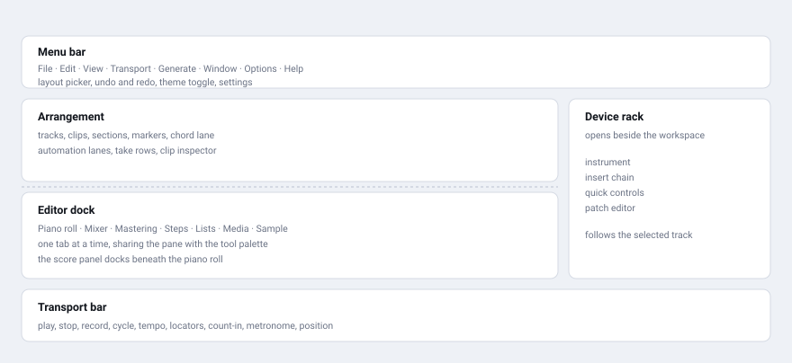

# sonare studio

[](https://github.com/libraz/sonare-studio/actions)
[](https://github.com/libraz/sonare-studio/blob/main/LICENSE)
[](https://www.typescriptlang.org/)
[](https://vuejs.org/)
[](https://github.com/libraz/sonare-studio)
[](https://sonare-studio.libraz.net)

**sonare studio is a browser sample app that drives [libsonare](https://github.com/libraz/libsonare)'s WebAssembly build end to end, and serves as its integration test bed.** Arrangement, piano roll, mixer, mastering, an engraved score and composition through [libcantus](https://github.com/libraz/libcantus) run inside the tab on that build. Nothing is uploaded: projects stay in the browser's own storage until you export them as ordinary files.

🎧 **[Open the app](https://sonare-studio.libraz.net)** &nbsp;·&nbsp; 📖 **[Documentation](https://github.com/libraz/sonare-studio/blob/main/docs/en/introduction.md)** &nbsp;·&nbsp; **[Getting started](https://github.com/libraz/sonare-studio/blob/main/docs/en/getting-started.md)** &nbsp;·&nbsp; **[Keyboard shortcuts](https://github.com/libraz/sonare-studio/blob/main/docs/en/shortcuts.md)**

> A sample application, not a supported production DAW. It is pre-1.0 and comes with no warranty, and the code has not been independently audited. A project file from an earlier schema version is upgraded on open; one from a newer version is refused. There is no compatibility promise across libsonare major versions.



## What it exercises

Each line below is driven through the UI by an end-to-end scenario.

- **Arrange** — tracks, MIDI and audio clips, sections, markers, a chord track estimated from the notes, tempo and meter maps, warp, freeze and bounce. [Arranging](https://github.com/libraz/sonare-studio/blob/main/docs/en/arranging.md)
- **Edit notes** — piano roll, playing-technique marks and expression maps, groove, controller lanes, MIDI FX, music typing with step input, and a step sequencer. [Editing notes](https://github.com/libraz/sonare-studio/blob/main/docs/en/editing-notes.md)
- **Play sound** — built-in synth presets, GM programs and drum kits, SoundFont (SF2) with GS insertion effects, and a multi-timbral channel map. [Instruments](https://github.com/libraz/sonare-studio/blob/main/docs/en/instruments.md)
- **Mix and master** — gain, mute, buses and sends, snapshots, VCA groups, inserts, fader automation, master meters, a suggested starting mix, and a mastering chain with presets and A/B preview. [Mixing and mastering](https://github.com/libraz/sonare-studio/blob/main/docs/en/mixing-and-mastering.md)
- **Read the score** — the active clip engraved with Verovio, chord symbols, annotations, print, PDF, and MusicXML / `.mxl` export and import. [Score](https://github.com/libraz/sonare-studio/blob/main/docs/en/score.md)
- **Compose** — chord progressions and generated parts from libcantus, reroll, a project seed, the theory card, the placement guide and secondary-dominant reharmonization. [Composing](https://github.com/libraz/sonare-studio/blob/main/docs/en/composing.md)
- **Record and analyse audio** — import, microphone recording, take comping and alignment, tempo, chord and section detection, audio-to-MIDI transcription, stem separation and the sample editor. [Recording and analysing audio](https://github.com/libraz/sonare-studio/blob/main/docs/en/audio-recording-and-analysis.md)
- **Move files in and out** — `.szd`, Standard MIDI File and MIDI 2.0 clip import and export, DAWproject, MusicXML, WAV, FLAC and MP3 mixdown, and WAV stems. [Files and formats](https://github.com/libraz/sonare-studio/blob/main/docs/en/files-and-formats.md)
- **Work offline** — installable PWA, English and Japanese UI, remappable shortcuts, save and continue, autosave, and named revisions. [Offline use and settings](https://github.com/libraz/sonare-studio/blob/main/docs/en/offline-and-settings.md)

## What it verifies

The scenarios in [`scripts/e2e/scenarios/`](https://github.com/libraz/sonare-studio/tree/main/scripts/e2e/scenarios) drive a production build through menus, panels, dock tabs and keys, then check the project document and the rendered audio. Through them the suite reaches these parts of libsonare:

- the project model
- realtime playback in the AudioWorklet and the offline renderer
- synth, GM and SoundFont synthesis
- mixer strips, insert effects and the mastering chain
- warp time-stretching
- audio analysis: take alignment, transcription and stem separation

[`scripts/e2e/api-map.md`](https://github.com/libraz/sonare-studio/blob/main/scripts/e2e/api-map.md) lists each call on libsonare's public surface with the scenarios that reach it. A full run compares the calls it records against the list and fails when they differ.

A wrong result in analysis, mastering or synthesis output is a libsonare bug. Report it in the [libsonare tracker](https://github.com/libraz/libsonare/issues), with the scenario that shows it if there is one.

## Getting started

[sonare-studio.libraz.net](https://sonare-studio.libraz.net) serves the hosted build of this repository, so there is nothing to install to use it, and nothing you open there is uploaded. The app needs a current Chromium- or Firefox-based browser. To run it locally you need Node 26 and Yarn 4 (pinned in `mise.toml`):

```sh
yarn install
yarn dev      # dev server with cross-origin-isolation headers; open the printed URL
yarn build    # production build into dist/
```

The start screen offers a new project or the bundled demo. Press **Play** and the audio engine boots on its own. Serving a build is covered in [Deployment](https://github.com/libraz/sonare-studio/blob/main/docs/en/deployment.md).

## Documentation

The documentation is plain Markdown under [`docs/`](https://github.com/libraz/sonare-studio/tree/main/docs), in English and Japanese.

- **Learn** — [Introduction](https://github.com/libraz/sonare-studio/blob/main/docs/en/introduction.md) · [Getting started](https://github.com/libraz/sonare-studio/blob/main/docs/en/getting-started.md)
- **Guides** — [Arranging](https://github.com/libraz/sonare-studio/blob/main/docs/en/arranging.md) · [Editing notes](https://github.com/libraz/sonare-studio/blob/main/docs/en/editing-notes.md) · [Instruments](https://github.com/libraz/sonare-studio/blob/main/docs/en/instruments.md) · [Mixing and mastering](https://github.com/libraz/sonare-studio/blob/main/docs/en/mixing-and-mastering.md) · [Score](https://github.com/libraz/sonare-studio/blob/main/docs/en/score.md) · [Composing](https://github.com/libraz/sonare-studio/blob/main/docs/en/composing.md) · [Recording and analysing audio](https://github.com/libraz/sonare-studio/blob/main/docs/en/audio-recording-and-analysis.md) · [Files and formats](https://github.com/libraz/sonare-studio/blob/main/docs/en/files-and-formats.md) · [Offline use and settings](https://github.com/libraz/sonare-studio/blob/main/docs/en/offline-and-settings.md) · [Keyboard shortcuts](https://github.com/libraz/sonare-studio/blob/main/docs/en/shortcuts.md) · [Deployment](https://github.com/libraz/sonare-studio/blob/main/docs/en/deployment.md)
- **Reference** — [Architecture](https://github.com/libraz/sonare-studio/blob/main/docs/en/architecture.md) · [Contributing](https://github.com/libraz/sonare-studio/blob/main/CONTRIBUTING.md)

## Non-goals

Not a supported production DAW, and no compatibility promise for project files across libsonare major versions. No MPE, no plugin hosting (VST/AU/CLAP), no notation editor beyond a few note gestures on the score, and no accounts, sync or collaboration. DAWproject and MusicXML round-trips are lossy by the nature of those formats, and the app lists what an export will drop before you confirm. [What it does not do](https://github.com/libraz/sonare-studio/blob/main/docs/en/introduction.md#what-it-does-not-do)

## License

[AGPL-3.0-or-later](LICENSE)
