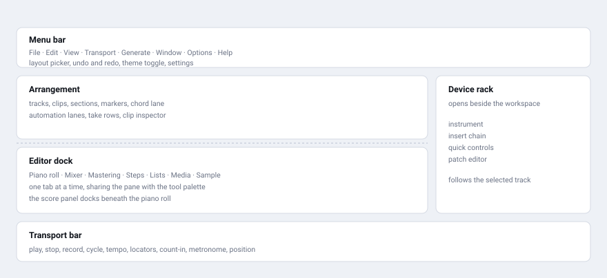

# sonare studio

[](https://github.com/libraz/sonare-studio/actions)
[](https://github.com/libraz/sonare-studio/blob/main/LICENSE)
[](https://www.typescriptlang.org/)
[](https://vuejs.org/)
[](https://github.com/libraz/sonare-studio)
[](https://sonare-studio.libraz.net)

**sonare studio は、[libsonare](https://github.com/libraz/libsonare) の WebAssembly ビルドをブラウザの UI から端から端まで動かすサンプルアプリで、そのビルドの統合テストの場を兼ねています。** アレンジ、ピアノロール、ミキサー、マスタリング、浄書した譜面、[libcantus](https://github.com/libraz/libcantus) による作曲が、そのビルドの上でタブの中で動きます。何もアップロードしません。プロジェクトは、普通のファイルとして書き出すまで、ブラウザ自身のストレージに置かれます。

🎧 **[アプリを開く](https://sonare-studio.libraz.net)** &nbsp;·&nbsp; 📖 **[ドキュメント](https://github.com/libraz/sonare-studio/blob/main/docs/ja/introduction.md)** &nbsp;·&nbsp; **[はじめに](https://github.com/libraz/sonare-studio/blob/main/docs/ja/getting-started.md)** &nbsp;·&nbsp; **[キーボードショートカット](https://github.com/libraz/sonare-studio/blob/main/docs/ja/shortcuts.md)**

> サンプルアプリであり、サポート対象の制作用 DAW ではありません。1.0 前で無保証です。コードは第三者による監査を受けていません。以前のスキーマ版のプロジェクトファイルは開くときに変換され、新しいスキーマ版のものは拒否されます。libsonare のメジャーバージョンをまたいだ互換性は約束しません。



## 動かしているもの

以下の各行は、end-to-end シナリオが UI から操作しています。

- **アレンジ** — トラック、MIDI クリップとオーディオクリップ、セクション、マーカー、ノートから推定するコードトラック、テンポマップと拍子マップ、ワープ、フリーズとバウンス。[アレンジ](https://github.com/libraz/sonare-studio/blob/main/docs/ja/arranging.md)
- **ノートを編集する** — ピアノロール、奏法マークとエクスプレッションマップ、グルーヴ、コントローラーレーン、MIDI FX、ミュージックタイピングとステップ入力、ステップシーケンサー。[ノートの編集](https://github.com/libraz/sonare-studio/blob/main/docs/ja/editing-notes.md)
- **音を鳴らす** — 内蔵シンセのプリセット、GM 音色とドラムキット、GS インサートエフェクト付きの SoundFont（SF2）、マルチティンバーのチャンネルマップ。[音源](https://github.com/libraz/sonare-studio/blob/main/docs/ja/instruments.md)
- **ミックスとマスタリング** — ゲイン、ミュート、スナップショット、VCA グループ、インサート、フェーダーのオートメーション、ミックスの提案、プリセットと A/B プレビュー付きのマスタリングチェイン。[ミックスとマスタリング](https://github.com/libraz/sonare-studio/blob/main/docs/ja/mixing-and-mastering.md)
- **譜面を読む** — アクティブクリップの Verovio による浄書、注釈、印刷、PDF、MusicXML と `.mxl` の書き出しと読み込み。[譜面](https://github.com/libraz/sonare-studio/blob/main/docs/ja/score.md)
- **作曲する** — libcantus によるコード進行とパートの生成、振り直し、理論カード、配置ガイド、セカンダリードミナントによるリハーモナイズ。[作曲](https://github.com/libraz/sonare-studio/blob/main/docs/ja/composing.md)
- **録音してオーディオを解析する** — 読み込み、マイク録音、テイクの位置合わせ、オーディオから MIDI への採譜、ステム分離、サンプルエディター。[オーディオの録音と解析](https://github.com/libraz/sonare-studio/blob/main/docs/ja/audio-recording-and-analysis.md)
- **ファイルを出し入れする** — `.szd`、Standard MIDI File と MIDI 2.0 クリップの書き出し、DAWproject、MusicXML、WAV のミックスダウンとステム。[ファイルと形式](https://github.com/libraz/sonare-studio/blob/main/docs/ja/files-and-formats.md)
- **オフラインで使う** — インストール可能な PWA、英語と日本語の UI、再割り当て可能なショートカット、保存して続行、名前付きリビジョン。[オフライン利用と設定](https://github.com/libraz/sonare-studio/blob/main/docs/ja/offline-and-settings.md)

## 検証しているもの

[`scripts/e2e/scenarios/`](https://github.com/libraz/sonare-studio/tree/main/scripts/e2e/scenarios) のシナリオは、本番ビルドをメニュー、パネル、ドックのタブ、キーから操作し、プロジェクトのドキュメントとレンダリングしたオーディオを確かめます。これを通じて、libsonare の次の部分を動かしています。

- プロジェクトモデル
- AudioWorklet でのリアルタイム再生とオフラインレンダラー
- シンセ、GM、SoundFont の音声合成
- ミキサーのストリップ、インサートエフェクト、マスタリングチェイン
- ワープのタイムストレッチ
- オーディオ解析（テイクの位置合わせ、採譜、ステム分離）

解析、マスタリング、音声合成の出力が間違っている場合は、libsonare のバグです。[libsonare のトラッカー](https://github.com/libraz/libsonare/issues)に報告してください。それを示すシナリオがあれば添えてください。

## はじめに

[sonare-studio.libraz.net](https://sonare-studio.libraz.net) でこのリポジトリのビルドを公開しているので、インストールせずに使えます。そこで開いたファイルはどこにもアップロードされません。アプリの実行には、最近の Chromium 系または Firefox 系のブラウザが必要です。ローカルで動かすには、Node 26 と Yarn 4（`mise.toml` で固定）が必要です。

```sh
yarn install
yarn dev      # dev server with cross-origin-isolation headers; open the printed URL
yarn build    # production build into dist/
```

スタート画面では、新規プロジェクトか同梱デモを選べます。**Play** を押すと、オーディオエンジンが自動で起動します。ビルドの配信方法は[デプロイ](https://github.com/libraz/sonare-studio/blob/main/docs/ja/deployment.md)にあります。

## ドキュメント

ドキュメントは [`docs/`](https://github.com/libraz/sonare-studio/tree/main/docs) 以下の Markdown で、英語版と日本語版があります。

- **学ぶ** — [概要](https://github.com/libraz/sonare-studio/blob/main/docs/ja/introduction.md) · [はじめに](https://github.com/libraz/sonare-studio/blob/main/docs/ja/getting-started.md)
- **ガイド** — [アレンジ](https://github.com/libraz/sonare-studio/blob/main/docs/ja/arranging.md) · [ノートの編集](https://github.com/libraz/sonare-studio/blob/main/docs/ja/editing-notes.md) · [音源](https://github.com/libraz/sonare-studio/blob/main/docs/ja/instruments.md) · [ミックスとマスタリング](https://github.com/libraz/sonare-studio/blob/main/docs/ja/mixing-and-mastering.md) · [譜面](https://github.com/libraz/sonare-studio/blob/main/docs/ja/score.md) · [作曲](https://github.com/libraz/sonare-studio/blob/main/docs/ja/composing.md) · [オーディオの録音と解析](https://github.com/libraz/sonare-studio/blob/main/docs/ja/audio-recording-and-analysis.md) · [ファイルと形式](https://github.com/libraz/sonare-studio/blob/main/docs/ja/files-and-formats.md) · [オフライン利用と設定](https://github.com/libraz/sonare-studio/blob/main/docs/ja/offline-and-settings.md) · [キーボードショートカット](https://github.com/libraz/sonare-studio/blob/main/docs/ja/shortcuts.md) · [デプロイ](https://github.com/libraz/sonare-studio/blob/main/docs/ja/deployment.md)
- **リファレンス** — [アーキテクチャ](https://github.com/libraz/sonare-studio/blob/main/docs/ja/architecture.md) · [Contributing](https://github.com/libraz/sonare-studio/blob/main/CONTRIBUTING.md)（英語のみ）

## 含まないもの（Non-goals）

サポート対象の制作用 DAW ではなく、libsonare のメジャーバージョンをまたいだプロジェクトファイルの互換性も約束しません。MPE、プラグインのホスト（VST/AU/CLAP）、譜面上の少数のノート操作を超える記譜エディター、アカウント、同期、共同編集は対象外です。DAWproject と MusicXML の往復は、それらの形式の性質上、不可逆です。アプリは、書き出しで失われる内容を、確定する前に一覧で示します。[できないこと](https://github.com/libraz/sonare-studio/blob/main/docs/ja/introduction.md#できないこと)

## ライセンス

[AGPL-3.0-or-later](LICENSE)
