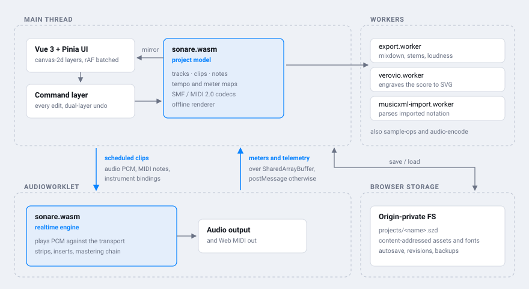

# Architecture

Vue 3 and Pinia drive the UI. The heavy surfaces (arrangement, piano roll, waveforms) are canvas-2d layers repainted through a requestAnimationFrame batcher in `src/ui/canvas/`.

## One wasm binary, two instances

libsonare ships as `sonare.wasm` inside the `@libraz/libsonare` package. The app bundles that one file and instantiates it twice from the same bytes.

On the main thread, and in workers for export, it is the project model and the offline renderer: tracks, clips, notes, tempo, the SMF and MIDI 2.0 codecs. Inside an AudioWorklet it is the realtime engine: it plays scheduled audio clips and MIDI against the transport and reports meters and telemetry. Control traffic uses SharedArrayBuffer when cross-origin isolation is available and degrades to postMessage otherwise (`src/engine/engine.ts`).

The worklet scope cannot fetch, so the main thread passes the wasm bytes in through `processorOptions.wasmBinary`. The worklet bundle is content-addressed (`public/assets/sonare-engine-worklet-<hash>.js`, built by `yarn build:worklet`) and its URL reaches the app through `.worklet-build/manifest.json`, so a refreshed engine can never be paired with a stale worklet.

Audio clips are scheduled into the realtime engine as PCM. MIDI clips are engine state too: `src/engine/midi-sync.ts` schedules their notes, with clip gain and fades, and engine instruments bound to each track's destination play them.

## Every edit goes through the command layer

The wasm `Project` instance is deliberately non-reactive. All edits go through `src/project/commands.ts`, which keeps a dual-layer undo history (wasm edits plus app-level metadata snapshots) and refreshes the reactive Pinia mirror that components read.

## Theory runs beside the engine, not inside it

`src/compose/` is plain TypeScript over libcantus and never touches wasm. It holds the adapters in both directions: project notes and the tempo/meter map go in as libcantus input, and chords, keys, sections, cadences, counterpoint verdicts and generated parts come back out as commands and as UI wording. Generation is seeded per project, so a reroll is reproducible.

## Notation is derived, never authored

The score panel quantizes the active clip's notes into a display model (`src/notation/model.ts`), serializes it to MusicXML and engraves it with Verovio in a worker. The pipeline itself never writes back to the MIDI, so re-transcription is only a re-render. The few edit gestures on the score are ordinary undoable note commands on the clip, after which the score is rebuilt. Print and PDF export consume the rendered SVG pages.

## Persistence

Projects are `.szd` archives (zip-packed JSON plus assets) stored in OPFS under `projects/<name>.szd`, with a debounced autosave slot, named revisions and whole-storage backups, alongside download and upload to local disk. Audio assets and SoundFonts are content-addressed in `assets/` and `fonts/`.
