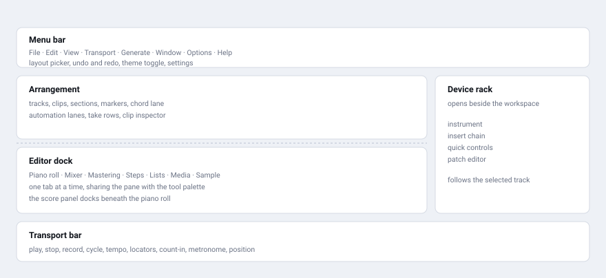

# Introduction

sonare studio is a digital audio workstation that runs entirely in the browser. There is no server and nothing is uploaded: the audio engine, the project model, the offline renderer and every export run inside the tab. Projects are stored in the browser's origin-private file system and leave it as ordinary files.

## Status

sonare studio is experimental software with no warranty. It is pre-1.0: the `.szd` project format can still change between releases. The code has not been independently reviewed or audited.

## Built on

- **[libsonare](https://github.com/libraz/libsonare)** is the audio side: a C++17 core compiled to WebAssembly, published as `@libraz/libsonare`. It owns the project model, the DSP, the mastering chain, the analysis and the offline renderer.
- **[libcantus](https://github.com/libraz/libcantus)** is the theory side: a dependency-free TypeScript library, published as `@libraz/libcantus`. It does chord spelling, key and form analysis, counterpoint rules, voicing and part generation. `src/compose/` adapts its results to the project model and to the wording the UI shows. None of it goes through wasm.
- **Verovio** engraves the score, and **Vue 3** with **Pinia** drives the UI.

How the pieces fit together is on the [architecture](architecture.md) page.

## What it does

**Arrange.** Multi-track timeline with MIDI and audio clips, sections, markers, a chord lane and a tempo/meter map. Clips split, crossfade, warp and freeze; sections can be detected from the material and coloured by what recurs.

**Edit notes.** Piano roll with a snap grid, velocity and controller lanes, ghost notes, ornaments, MIDI FX, expression maps, groove, QWERTY music typing and step input. A step sequencer covers pattern, Euclidean and randomize work.

**Play sound.** Per-track instruments: built-in synth presets, built-in GM/GS programs and drum kits, SoundFont (SF2) playback, and GM-style multi-timbral setups where channel 10 is the drum kit. SF2 instruments can use Modern or Classic GS insertion effects when the imported MIDI contains GS EFX SysEx. Each track gets an insert chain and quick controls in the device rack.

**Mix and master.** Channel strips with gain, pan, sends, EQ and inserts, plus bus and VCA strips, mixer snapshots, sidechain keys, solo-safe and per-strip automation. Metering covers level, gain reduction, spectrum and goniometer on the master and every strip. The master bus carries a mastering chain (EQ, multiband dynamics, saturation, stereo tools, a true-peak maximizer) with A/B preview and streaming-loudness targets.

**Read the score.** The active clip is engraved with Verovio, with chord-symbol estimation, page layout, print, PDF and MusicXML export. Annotations (dynamics, articulations, slurs) and an engraving-only transpose apply from the score panel; the piano roll's Decorate panel places ghosts, flams, drags, slides and accents across a whole clip where the meter admits them. None of it writes back to the MIDI; see [Notation is derived](architecture.md#notation-is-derived-never-authored).

**Compose.** Generate a chord progression by style and preset, or fit one to an existing melody, then generate parts over it: motif, drums, bass, counter melody and chord backing, each with its own groove, contour, register and voicing. One project seed drives the whole arrangement, so a reroll is reproducible. Reharmonization works diatonically or through secondary and borrowed chords, and can run reactively as you edit.

A guidance card reads the note under the cursor against the current chord and key: scale degree, chord tone or tension, cadence arrival, modulation pivot and counterpoint against the voice below, in beginner, normal or theory wording. Before you place a note, the piano roll's placement guide shades each pitch of the target column as safe, caution or avoid against every other part, under a counterpoint or pop profile; drum notes never count. An accompaniment track set to Follow melody thins the non-root notes that clash with the melody and restores them once the clash clears, in the same undo step as the edit. Detect key changes proposes modulation points from the notes and adds the ones you keep as Key: markers, and a track's pitch range can be set to a voice or instrument preset.

**Record and analyse audio.** Microphone recording with monitoring, count-in, metronome, punch and cycle recording into takes, then comping across them. Imported audio can be analysed for tempo, chords and sections, transcribed to a MIDI clip in Melody or Polyphonic mode, or split into harmonic, percussive and residual stems. Transcription runs in a cancellable worker and adds its track and notes as one undoable edit; Polyphonic mode reads long clips in overlapping chunks and refuses a clip only when a 256 MiB memory budget cannot hold one chunk. A sample editor handles clip content, and the media browser filters assets by key and BPM and sorts them by loudness.

**Move files in and out.** `.szd` projects, DAWproject, Standard MIDI File, MIDI 2.0 clip files, MusicXML, separated stems, and WAV / FLAC / MP3 mixdown (plus AAC and Opus where the browser provides them). Audio exports can render per-track, per-bus and master stems, and report loudness and clipping; a streamed WAV mixdown without a mastering chain reports sample peak only and says so in its report. Where a format cannot carry something, the dialog lists exactly what will be dropped before you confirm.

**Live in the app.** Installable as a PWA and usable offline, with `.szd` file handling from the OS. English and Japanese UI, five note-name systems, light and dark themes, remappable shortcuts with a `?` cheatsheet, a command palette, MIDI learn and control-surface bindings, a first-run tour, a keyboard object navigator for the canvas surfaces, and named workspace layouts (Compose, Mix, Score, Arrange). Autosave and named revisions run against browser storage, and browser backup import/export moves the whole store in one file. The keys are listed on the [keyboard shortcuts](shortcuts.md) page.

## What it does not do

- **No MPE.** Expression lanes use MIDI 1.0 channels, and polyphonic pressure is stored per pitch rather than per note.
- **No plugin hosting.** Instruments and effects are the ones the engine ships; there is no VST/AU/CLAP bridge.
- **The score is not a notation editor.** It edits notes through a few gestures (add, delete, re-pitch; see [keyboard shortcuts](shortcuts.md)), but there is no note-value, rest or beam entry, and layout is always derived.
- **No accounts, sync or collaboration.** One browser profile, one set of projects.
- **Round-trips are lossy** for DAWproject and MusicXML, by the nature of those formats. The app lists what it is about to drop rather than dropping it quietly.
