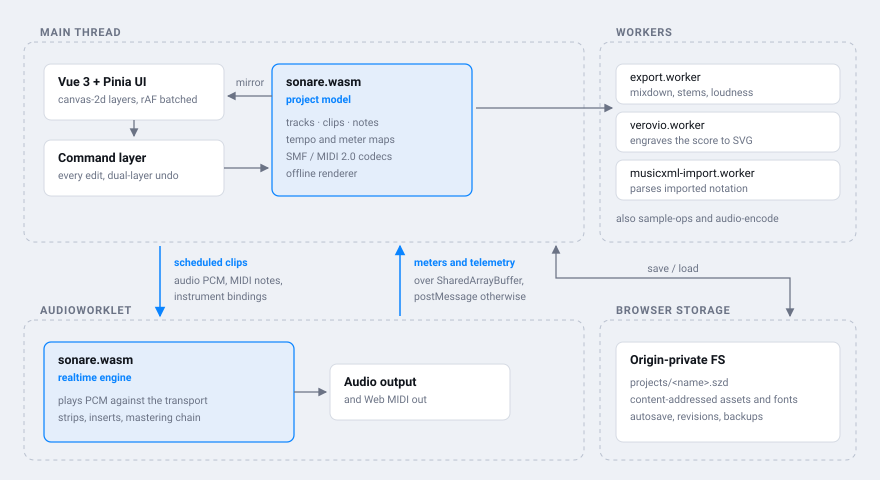

# アーキテクチャ

UI は Vue 3 と Pinia で動かします。アレンジ、ピアノロール、波形といった重い面は canvas-2d のレイヤーで、`src/ui/canvas/` の requestAnimationFrame バッチャーを通して再描画します。

## 1 つの wasm バイナリを 2 回インスタンス化する

libsonare は `@libraz/libsonare` パッケージ内の `sonare.wasm` として配布されます。アプリはこの 1 ファイルをバンドルし、同じバイト列から 2 回インスタンス化します。

メインスレッドと書き出し用のワーカーでは、プロジェクトモデルとオフラインレンダラーとして働きます。トラック、クリップ、ノート、テンポ、SMF と MIDI 2.0 のコーデックがここにあります。AudioWorklet の中ではリアルタイムエンジンとして働き、トランスポートに合わせてスケジュール済みのオーディオクリップと MIDI を再生し、メーターとテレメトリを返します。制御の通信は、クロスオリジン分離が有効なら SharedArrayBuffer を使い、無効なら postMessage に切り替わります（`src/engine/engine.ts`）。

ワークレットのスコープからは fetch できないため、wasm のバイト列はメインスレッドが `processorOptions.wasmBinary` で渡します。ワークレットのバンドルは内容アドレス方式です（`public/assets/sonare-engine-worklet-<hash>.js`、`yarn build:worklet` が生成）。その URL は `.worklet-build/manifest.json` 経由でアプリに届くため、更新後のエンジンが古いワークレットと組み合わさることはありません。

オーディオクリップは PCM としてリアルタイムエンジンへスケジュールします。MIDI クリップもエンジンの状態です。`src/engine/midi-sync.ts` がクリップのゲインとフェードを付けてノートをスケジュールし、各トラックの出力先に結び付いたエンジン内の音源が再生します。

## 編集はすべてコマンド層を通る

wasm の `Project` インスタンスは、意図的にリアクティブにしていません。編集はすべて `src/project/commands.ts` を通ります。ここが、wasm 側の編集とアプリ側メタデータのスナップショットという二層の undo 履歴を持ち、コンポーネントが読む Pinia のリアクティブなミラーを更新します。

## 理論はエンジンの中ではなく隣で動く

`src/compose/` は libcantus の上に載る素の TypeScript で、wasm には触れません。ここに双方向のアダプターがあります。プロジェクトのノートとテンポ／拍子マップを libcantus の入力へ変換し、返ってきたコード、キー、セクション、終止、対位法の判定、生成されたパートを、コマンドと UI の文言へ戻します。生成はプロジェクト単位のシードで動くので、振り直しても結果を再現できます。

## 譜面は導出物で、入力手段ではない

スコアパネルは、アクティブクリップのノートを表示用のモデルへクオンタイズし（`src/notation/model.ts`）、MusicXML へ直列化して、ワーカー内の Verovio で浄書します。この経路自体は MIDI へ書き戻さないので、採譜し直しても再描画にすぎません。譜面上の少数の編集操作は、クリップに対する通常の取り消し可能なノートコマンドで、実行後に譜面を作り直します。印刷と PDF 書き出しは、浄書された SVG ページを使います。

## 永続化

プロジェクトは `.szd` アーカイブ（JSON とアセットを zip でまとめたもの）として、OPFS の `projects/<name>.szd` に保存します。デバウンス付きの自動保存スロット、名前付きリビジョン、ストレージ全体のバックアップがあり、ローカルディスクとのダウンロード／アップロードにも対応します。オーディオアセットと SoundFont は、`assets/` と `fonts/` に内容アドレスで置きます。
