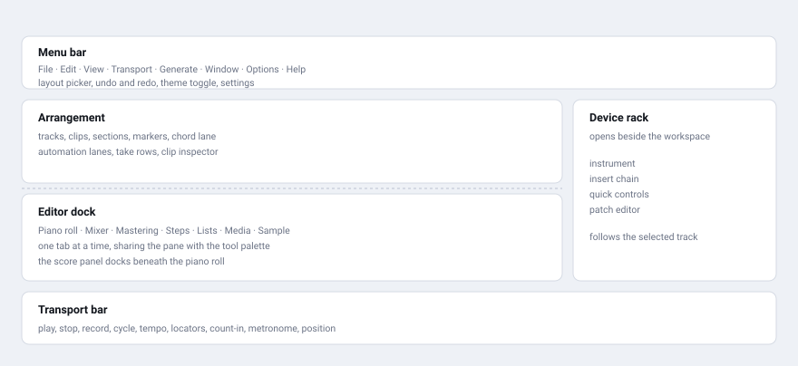

# 概要

sonare studio は、ブラウザの中だけで動くデジタルオーディオワークステーションです。サーバーはなく、何もアップロードしません。オーディオエンジン、プロジェクトモデル、オフラインレンダラー、すべての書き出しが、タブの中で動きます。プロジェクトはブラウザの origin-private file system に保存され、普通のファイルとして取り出せます。

## ステータス

sonare studio は、無保証の実験的なソフトウェアです。1.0 前のため、`.szd` プロジェクト形式はリリース間で変わることがあります。コードは第三者によるレビューや監査を受けていません。

## 土台

- **[libsonare](https://github.com/libraz/libsonare)** がオーディオ側です。C++17 のコアを WebAssembly にコンパイルしたもので、`@libraz/libsonare` として公開されています。プロジェクトモデル、DSP、マスタリングチェイン、解析、オフラインレンダラーを持ちます。
- **[libcantus](https://github.com/libraz/libcantus)** が理論側です。`@libraz/libcantus` として公開されている、依存ゼロの TypeScript ライブラリで、和音の綴り、キーと形式の解析、対位法の規則、ボイシング、パート生成を担当します。`src/compose/` が、その結果をプロジェクトモデルと UI の文言に合わせます。wasm は通りません。
- 譜面の浄書は **Verovio**、UI は **Vue 3** と **Pinia** です。

各部品のつながりは、[アーキテクチャ](architecture.md)のページにあります。

## 関連プロジェクト

- **[libsonare-mcp](https://github.com/libraz/libsonare-mcp)** は、AI アシスタントが libsonare を通じてオーディオと MIDI の解析、編集、マスタリング、ミックス、作曲を行うための MCP サーバーです。
- libsonare のドキュメントサイトは [libsonare.libraz.net](https://libsonare.libraz.net) です。

## できること

**アレンジ**。MIDI クリップとオーディオクリップ、セクション、マーカー、コードレーン、テンポ／拍子マップを持つマルチトラックのタイムラインです。クリップは分割、クロスフェード、ワープ、フリーズができます。セクションは素材から検出でき、繰り返し方に応じて色が付きます。

**ノートを編集する**。ピアノロールには、スナップグリッド、ベロシティとコントローラーのレーン、ゴーストノート、装飾、MIDI FX、エクスプレッションマップ、グルーヴ、QWERTY キーでの音符入力（ミュージックタイピング）とステップ入力があります。パターン、ユークリッド、ランダマイズはステップシーケンサーが受け持ちます。

**音を鳴らす**。トラックごとの音源として、内蔵シンセのプリセット、内蔵 GM/GS 音色とドラムキット、SoundFont（SF2）再生、チャンネル 10 をドラムキットとする GM 相当のマルチティンバー構成を選べます。読み込んだ MIDI に GS EFX SysEx が含まれる場合、SF2 音源では GS インサートエフェクトを Modern か Classic から選べます。各トラックのインサートチェインとクイックコントロールは、デバイスラックに並びます。

**ミックスとマスタリング**。チャンネルストリップは、ゲイン、パン、センド、EQ、インサートを備えます。ほかに、バスストリップと VCA ストリップ、ミキサースナップショット、サイドチェインキー、ソロセーフ、ストリップ単位のオートメーションがあります。メーターは、レベル、ゲインリダクション、スペクトラム、ゴニオメーターを、マスターと全ストリップで表示します。マスターバスには、EQ、マルチバンドダイナミクス、サチュレーション、ステレオツール、トゥルーピークマキシマイザーからなるマスタリングチェインがあり、A/B プレビューと配信ラウドネスターゲットが付きます。

**譜面を読む**。アクティブクリップを Verovio で浄書し、コードシンボルの推定、ページレイアウト、印刷、PDF と MusicXML の書き出しに対応します。注釈（強弱、アーティキュレーション、スラー）と浄書だけの移調は、スコアパネルから適用します。ピアノロールの Decorate パネルは、ゴースト、フラム、ドラッグ、スライド、アクセントを、拍子が許す位置へクリップ全体にまとめて置きます。いずれも MIDI には書き戻しません。詳しくは[譜面は導出物で、入力手段ではない](architecture.md#譜面は導出物で入力手段ではない)を参照してください。

**作曲する**。スタイルとプリセットからコード進行を生成するか、既存のメロディーに合わせてコード進行を付け、その上にパートを生成します。パートはモチーフ、ドラム、ベース、対旋律、コードバッキングで、それぞれにグルーヴ、コンター、レジスター、ボイシングを指定できます。アレンジ全体は 1 つのプロジェクトシードから生成するので、振り直しても同じ結果を再現できます。リハーモナイズは、ダイアトニックでも、セカンダリーコードや借用和音を使っても行え、編集に追従して自動で実行することもできます。

ガイダンスカードは、カーソル下の音を現在のコードとキーに照らして読み、スケール度数、コードトーンかテンションか、終止の到達点、転調のピボット、下声部に対する対位法を、初心者・通常・理論のいずれかの言い回しで示します。音符を置く前には、ピアノロールの配置ガイドが、置こうとしている列の各音高を、他のすべてのパートに対して「そのまま置ける」「注意して置く」「避ける」の 3 段階で塗り分けます。判定プロファイルは対位法とポップスから選べ、ドラムのノートは判定に含まれません。伴奏トラックに「追従する旋律」を設定すると、旋律と衝突するルート以外の音を間引き、衝突がなくなれば元に戻します。間引きと復元は、元の編集と同じ undo の 1 手に収まります。「調の変化を検出」はノートから転調候補を推定し、選んだものを Key: マーカーとして追加します。トラックの音域は、声部や楽器のプリセットに設定できます。

**録音してオーディオを解析する**。マイク録音は、モニタリング、カウントイン、メトロノーム、パンチ録音、サイクル録音によるテイク取りに対応し、テイク間のコンピングもできます。読み込んだオーディオは、テンポ、コード、セクションを解析できます。メロディまたはポリフォニックのモードで MIDI クリップへ採譜することも、ハーモニック・パーカッシブ・残差のステムに分離することもできます。採譜はキャンセル可能なワーカーで実行し、トラックとノートの追加は 1 回の undo で戻せます。ポリフォニックモードは長いクリップを重なりのあるチャンクに分けて読み、1 チャンクが 256 MiB のメモリ予算に収まらない場合だけクリップを拒否します。クリップの中身はサンプルエディターで編集します。メディアブラウザーは、キーと BPM でアセットを絞り込み、ラウドネスで並べ替えます。

**ファイルを出し入れする**。`.szd` プロジェクト、DAWproject、Standard MIDI File、MIDI 2.0 クリップファイル、MusicXML、分離済みステム、WAV / FLAC / MP3 のミックスダウン（ブラウザが対応していれば AAC と Opus も）を扱います。オーディオ書き出しでは、トラック別、バス別、マスターのステムをレンダリングでき、ラウドネスとクリップを報告します。マスタリングチェインを通さないストリーミング WAV のミックスダウンは、サンプルピークだけを報告し、その旨をレポートに記載します。形式が表現できないものがある場合は、確定前に、ダイアログが失われる内容を列挙します。

**アプリとして使う**。PWA としてインストールでき、オフラインでも動き、OS 側から `.szd` を開けます。UI は英語と日本語、音名は 5 方式、テーマはライトとダークに対応します。ショートカットは再割り当てでき、`?` でチートシートが出ます。ほかに、コマンドパレット、MIDI ラーンとコントロールサーフェスの割り当て、初回起動ツアー、キャンバス面をキーボードで辿るオブジェクトナビゲーター、名前付きワークスペースレイアウト（作曲、ミックス、譜面、アレンジ）があります。ブラウザストレージに対しては、自動保存と名前付きリビジョンが動き、ブラウザのバックアップの書き出しと読み込みで、ストレージ全体を 1 つのファイルで移せます。キーの一覧は[キーボードショートカット](shortcuts.md)のページにあります。

## できないこと

- **MPE には対応していません**。エクスプレッションレーンは MIDI 1.0 のチャンネルを使い、ポリフォニックプレッシャーはノート単位ではなく音高単位で保持します。
- **プラグインはホストしません**。音源とエフェクトはエンジンに入っているものだけで、VST/AU/CLAP のブリッジはありません。
- **譜面は音符の入力エディターではありません**。譜面上でできる編集は、いくつかの操作（追加、削除、音高変更。[キーボードショートカット](shortcuts.md)を参照）に限られ、音価、休符、連桁の入力はなく、レイアウトは常に導出されます。
- **アカウント、同期、共同編集はありません**。1 つのブラウザプロファイルに 1 組のプロジェクトです。
- **DAWproject と MusicXML の往復は不可逆です**。これは形式側の性質によるものです。黙って落とすのではなく、落とす内容を事前に提示します。
